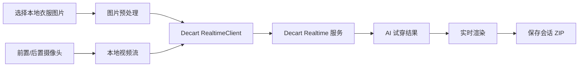

# 卡布达

> 基于 Decart Realtime Android SDK 的实时 AI 虚拟试穿 Android 应用。

[](https://developer.android.com/studio/releases/platforms)
[](https://kotlinlang.org)
[](https://developer.android.com/studio/releases/platforms)
[](https://docs.platform.decart.ai/sdks/android)

卡布达允许用户从手机本地选择衣服图片，结合前置或后置摄像头画面，通过 Decart Realtime 服务实时生成 AI 试穿结果。

项目是一个独立的 Android MVP，不包含 AnyWear 的专有代码、素材、模型权重或服务端。

## 核心功能

- 通过系统 Photo Picker 选择本地衣服图片
- 自动处理 EXIF 方向，并缩放、压缩为适合传输的 JPEG
- 前置/后置摄像头实时预览，支持一键切换
- 连接 Decart Realtime 服务并实时渲染 AI 试穿结果
- 支持多个 Lucy Realtime 模型
- 远端画面出现后，本地预览自动切换为画中画
- 展示连接状态、错误信息和操作提示
- 保存商品图、元数据以及本地/输出帧组成的会话 ZIP
- 支持分享会话记录
- API Key、实时地址和模型均可在 App 内配置
- 可选后端支持反馈、计费状态和匿名遥测
- 敏感配置仅保存在设备本地，不写入源码或 APK

## 工作原理



主要流程：

1. 在设置中保存 Decart API Key、实时地址和模型名称；
2. 选择衣服图片，并转换为服务端要求的纯 Base64 JPEG；
3. 创建摄像头本地视频流；
4. 调用 `RealTimeClient.connect()` 传入衣服图片和摄像头流；
5. 通过 WebSocket 信令与 WebRTC/LiveKit 媒体通道接收远端结果；
6. 渲染 AI 输出，并按需保存当前会话。

## 环境要求

- JDK 17
- Android SDK 35
- Android Studio 或 Android 命令行构建工具
- 支持前后摄像头的 Android 真机
- Android 7.0（API 24）及以上
- 可访问 Decart Realtime 服务的网络
- 有效的 Decart API Key

## 快速开始

### 1. 克隆仓库

```bash
git clone https://github.com/cdcRyan/kabuda-vton-android.git
cd kabuda-vton-android
```

### 2. 创建本机配置

```bash
cp local.properties.example local.properties
```

编辑 `local.properties`：

```properties
sdk.dir=/your/android/sdk/path

# 以下均为可选构建默认值，可在 App 设置中覆盖
API_BASE_URL=
REALTIME_SIGNALING_URL=wss://api.decart.ai
DEFAULT_MODEL_NAME=lucy-vton-latest
```

`local.properties` 已被 `.gitignore` 排除，请勿提交到 Git。

### 3. 构建 Debug APK

```bash
./gradlew assembleDebug
```

生成的安装包：

```text
app/build/outputs/apk/debug/app-debug.apk
```

连接 Android 真机后，也可以直接安装：

```bash
./gradlew installDebug
```

### 4. 运行测试

```bash
./gradlew test assembleDebug
```

## App 内配置

首次使用时，进入设置并填写以下内容：

| 配置项 | 默认值 | 是否必填 | 用途 |
| --- | --- | --- | --- |
| Decart API Key | 无 | 是 | 连接 Decart Realtime 服务 |
| Decart 实时地址 | `wss://api.decart.ai` | 是 | WebSocket 信令地址 |
| 模型名称 | `lucy-vton-latest` | 是 | 选择 Realtime 模型 |
| 可选后端 API 地址 | 空 | 否 | 反馈、日志和计费状态 |
| 匿名遥测与反馈 | 开启 | 否 | 可在设置中关闭 |

API Key 和其他运行时配置仅保存在本机 `SharedPreferences` 中。

当前支持的模型：

```text
lucy-2.1
lucy-2.5
lucy-vton-3.5
lucy-vton-3.6
lucy-restyle-2
lucy-latest
lucy-vton-latest
lucy-restyle-latest
```

## 使用步骤

1. 安装并打开卡布达；
2. 进入设置，填写 Decart API Key，并保存其他连接配置；
3. 返回主界面，从手机相册选择衣服图片；
4. 开启摄像头并授予相机权限，可在预览中切换前置或后置镜头；
5. 开始试穿并等待远端 AI 输出；
6. AI 输出出现后，本地预览会自动切换为画中画；
7. 打开会话面板，保存或分享当前会话 ZIP；
8. 如果配置了可选后端，还可以提交反馈或查看计费状态。

## 技术栈

| 类别 | 技术 |
| --- | --- |
| 开发语言 | Kotlin 2.1.0 |
| Android 构建 | Gradle 8.7 / Android Gradle Plugin 8.5.2 |
| 最低 / 目标 SDK | API 24 / API 35 |
| UI | Android XML + View Binding |
| Realtime SDK | Decart Android SDK `0.8.2` 源码 + 本地协议兼容补丁（`decart-sdk` 模块） |
| HTTP | Retrofit 2.11 + OkHttp 4.12 |
| 图片处理 | Android Photo Picker + ExifInterface |
| 本地存储 | SharedPreferences |
| 会话归档 | ZIP |

## 项目结构

```text
app/src/main/java/ai/anywear/mvp/
├── KabudaApplication.kt
├── MainActivity.kt                    # 试穿主流程
├── SettingsActivity.kt                # 运行时配置
├── data/
│   ├── AppPreferences.kt              # 本地配置
│   ├── BackendConfig.kt               # URL 校验和构建默认值
│   ├── TryOnApi.kt                    # 可选后端接口
│   ├── TryOnModels.kt                 # 数据模型
│   └── TryOnRepository.kt             # 后端数据层
├── realtime/
│   └── DecartRealtimeSession.kt       # Decart Realtime 连接
└── recording/
    └── SessionArchive.kt              # 会话 ZIP 保存与分享
```

`decart-sdk/` 是 Decart 官方 Android SDK `0.8.2` 的本地副本。它包含一项
协议兼容补丁，并保留上游 MIT 许可证和补丁说明，详见
`decart-sdk/PATCHES.md`。

## 常见问题

### Missing API key

- 检查设置中的 API Key 是否已填写并保存；
- 确认 Key 没有多余空格、`Bearer` 前缀或引号；
- 确认 Key 未被撤销，并具有对应模型权限；
- 重新打开设置，确认配置仍然存在。

### Signaling error

- 使用支持相机功能的 Android 真机；
- 授予 App 相机权限；
- 关闭可能拦截 WebRTC 的 VPN、代理或网络过滤工具；
- 尝试切换 Wi-Fi 或手机热点；
- 确认网络允许 HTTPS/WSS 443 和 UDP WebRTC 流量；
- 优先保持默认实时地址和官方模型。

### 相机无法打开

- 检查系统设置中是否已允许卡布达使用相机；
- 关闭其他正在独占摄像头的应用；
- 使用真实设备测试，模拟器可能不支持所需 Realtime 功能。

## 官方文档

- [Decart Android SDK](https://docs.platform.decart.ai/sdks/android)
- [Android Realtime](https://docs.platform.decart.ai/sdks/android-realtime)
- [Realtime 最佳实践](https://docs.platform.decart.ai/models/realtime/streaming-best-practices)
- [网络要求](https://docs.platform.decart.ai/integrations/network-requirements)
- [Decart 状态页](https://status.decart.ai)

## 安全与隐私

- 不要把永久 API Key 写入源码、Gradle 文件、示例配置或提交记录；
- `local.properties`、签名文件、APK、日志和构建产物均已被 `.gitignore` 排除；
- 开始试穿后，衣服图片和摄像头帧会发送至配置的 Decart Realtime 服务；
- 如果配置可选后端，反馈功能可能上传本地帧和输出帧；
- 应用清单已禁用 Android 自动备份；
- 正式发布建议使用自己的后端签发短期 Client Token；
- 上架前应补充隐私政策，明确说明数据用途、保留周期和第三方服务。

## 当前限制

- MVP 不包含登录、应用商店计费、自有推理后端或服务端余额页面；
- 反馈、计费和日志功能需要可选后端；
- “保存会话”保存图片与元数据，不录制视频；
- 尚未提供签名 Release 构建；
- 尚未发布正式开源许可证。

## 参与贡献

欢迎提交 Issue 和 Pull Request：

1. Fork 本仓库；
2. 创建功能分支；
3. 完成修改并运行 `./gradlew test assembleDebug`；
4. 提交清晰的变更说明；
5. 发起 Pull Request。

## License

本仓库暂未指定开源许可证。未经明确许可，请勿将项目用于商业再发布。
